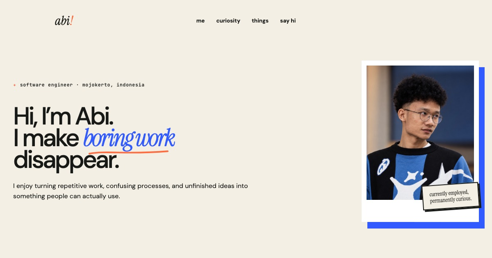

# abiekaputra.is-a.dev

The personal corner of **Abi Eka Putra Wulyono**, a Software Engineer from
Mojokerto who likes making repetitive work disappear.

**Live:** <https://abiekaputra.is-a.dev>



## Why this website exists

GitHub already holds the code, screenshots, architecture, tests, and technical
documentation. This website has a different job: introduce the person behind
that work and leave enough curiosity for a visitor to explore further.

It is intentionally not a resume clone or a project evidence gallery. The page
focuses on Abi's instinct for automation, recurring technical curiosities,
fragments of his journey, and a handful of direct paths into GitHub.

## Experience principles

- Personal before promotional.
- Short stories instead of defensive project claims.
- Project names act as doors to GitHub, not miniature case studies.
- Warm, playful composition instead of a dashboard or engineering dossier.
- Hover adds delight, while touch users retain all essential information.
- Motion respects `prefers-reduced-motion`.
- Desktop, tablet, and phone layouts are designed independently.

## Selected rabbit holes

- [Nilik](https://github.com/abiekaputra/nilik)
- [ZapX](https://github.com/abiekaputra/zapx)
- [Tapak](https://github.com/abiekaputra/tapak)
- [Satset](https://github.com/abiekaputra/satset)
- [SIMONIKA](https://github.com/abiekaputra/simonika)
- [AWAIR](https://github.com/abiekaputra/awair)

## Implementation

- Semantic, buildless HTML.
- Modular CSS with every production file below 300 lines.
- A small vanilla JavaScript layer for partial loading, navigation, reveal
  states, project color play, email copying, and one hidden joke.
- Prettier formatting and an automated source, asset, content, and line-limit
  validator.
- GitHub Actions quality checks on every push and pull request.
- GitHub Pages hosting through the preserved `abiekaputra.is-a.dev` CNAME.

## Run locally

```bash
npm install
python3 -m http.server 4173
```

Open <http://127.0.0.1:4173>.

## Contact

- [Email](mailto:abiekapw@gmail.com)
- [GitHub](https://github.com/abiekaputra)
- [LinkedIn](https://www.linkedin.com/in/abiekaputrawulyono)
- [Instagram](https://www.instagram.com/beka.ptr)

## License

Source code is available under the [MIT License](LICENSE). The profile photo and
personal career narrative remain identity content and are not granted for reuse
as another person's portfolio.
